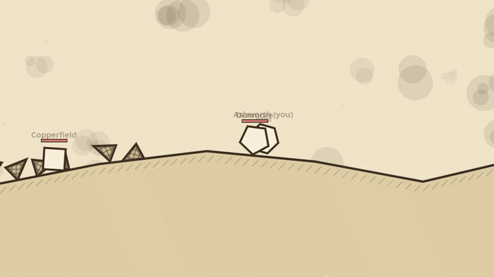
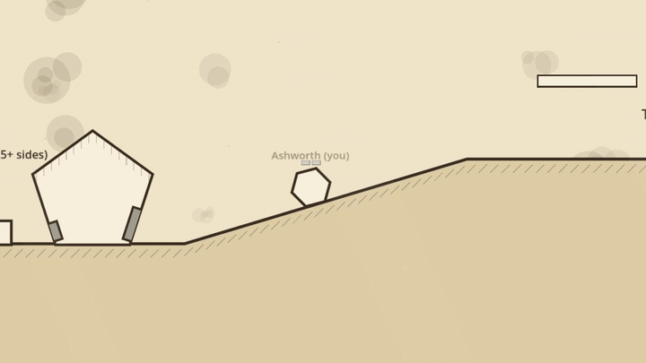

# Flatland

A multiplayer Flatland roguelite, built with Godot 4.5 (GDScript).
The design lives in `docs/DESIGN.md`.





The GIFs are scripted runs of the real game. To record them again after the
art changes: `tools/record/make_gifs.sh` (needs ffmpeg; see
`tools/record/clips.gd`).

## Setup

You need Godot 4.5.1. The commands below use an alias for the macOS app
binary:

```sh
alias godot=/Applications/Godot.app/Contents/MacOS/Godot
```

Run every command from the project root (the folder with `project.godot`).

## Run a dedicated server

```sh
godot --headless --path . -- --server
```

- Listens on port `24680`. To use another port, add `--port=NNNN` after the `--`:
  `godot --headless --path . -- --server --port=25000`
- `--headless` runs it with no window. The server has no local player.
- It prints `Server listening on port 24680`, and a line each time a player
  joins or leaves. Stop it with `Ctrl+C`.

Options after the lone `--` belong to the game. Options before it belong to Godot.

## Saves and logins

A dedicated server keeps every player's families either in local files or
in Supabase. The `SAVES` setting picks which (offline play and hosting from
the menu always use this machine's files).

| `SAVES` | Saves | Players log in with |
|---|---|---|
| `local` | JSON files in `--save-dir` (default `user://server/`) | a device id, no login screen |
| `supabase` | the Supabase project in `SUPABASE_URL` | Google |

The settings live in `.env` (gitignored). Copy the example, fill it in, and
load it into your shell before starting the server:

```sh
cp .env.example .env
set -a; source .env; set +a
godot --headless --path . -- --server
```

The server prints which store it's using, for example
`Saves: Supabase at http://127.0.0.1:54321; logins: supabase`. With
`SAVES=supabase` and a missing setting, it won't start and says which one
is missing.

### Run Supabase locally

You need Docker Desktop (running) and the Supabase CLI
(`brew install supabase/tap/supabase`). Supabase calls `docker`, so put it
on your PATH (add this to `~/.zshrc`):

```sh
export PATH="$HOME/.docker/bin:$PATH"
```

Then, from the project root:

```sh
supabase start     # first run downloads images; creates the save tables
supabase status    # prints the URL and keys
```

Put these in `.env`, copying the two keys from `supabase status` (they're
Supabase's standard local development keys, the same on every machine):

```sh
SAVES=supabase
SUPABASE_URL=http://127.0.0.1:54321
SUPABASE_SECRET_KEY=<Secret key from supabase status>
SUPABASE_PUBLISHABLE_KEY=<Publishable key from supabase status>
```

- Dashboard: <http://127.0.0.1:54323> (Table Editor → `families`, `chests`).
- `supabase stop` stops it and keeps the data; `supabase db reset` wipes
  the data and reapplies `supabase/migrations/`.
- Google login locally needs a Google OAuth client with the redirect URI
  `http://127.0.0.1:54321/auth/v1/callback`, and
  `SUPABASE_AUTH_EXTERNAL_GOOGLE_CLIENT_ID` / `SUPABASE_AUTH_EXTERNAL_GOOGLE_SECRET`
  exported in your shell before `supabase start`.

### Test without Google

Make a password user and get a login token for it:

```sh
U=http://127.0.0.1:54321
SK=<Secret key from supabase status>
PK=<Publishable key from supabase status>
curl -s -X POST $U/auth/v1/admin/users -H "apikey: $SK" -H "Authorization: Bearer $SK" \
  -H "Content-Type: application/json" \
  -d '{"email":"tester@example.com","password":"test-password-1","email_confirm":true}'
TOKEN=$(curl -s -X POST "$U/auth/v1/token?grant_type=password" -H "apikey: $PK" \
  -H "Content-Type: application/json" \
  -d '{"email":"tester@example.com","password":"test-password-1"}' \
  | python3 -c 'import sys,json; print(json.load(sys.stdin)["access_token"])')
```

With a Supabase server running on port 24696 (as above, plus `--port=24696`),
the online test logs in with that token, plays, leaves and checks the save
came back:

```sh
godot --headless --path . -s tools/tests/test_online.gd -- --port=24696 --token=$TOKEN
```

The token lasts an hour.

### Tests with the mock Supabase

For quick tests there's a small stand-in for Supabase that needs no Docker.
It uses port 54321 too, so stop local Supabase first (`supabase stop`).

```sh
python3 tools/tests/supabase_mock.py --port 54321 --secret sb_secret_test &
SUPABASE_URL=http://127.0.0.1:54321 SUPABASE_SECRET_KEY=sb_secret_test \
  godot --headless --path . -s tools/tests/test_supabase_store.gd
SUPABASE_URL=http://127.0.0.1:54321 godot --headless --path . -s tools/tests/test_auth.gd
godot --headless --path . -s tools/tests/test_saves.gd   # no mock needed
```

The mock's tokens are `good-token-1` and `good-token-2`; its publishable
key is `sb_publishable_test`.

### Push tables and auth settings to the hosted project

The **002-deploy-code** GitHub workflow does this on each deploy (see
`deploy/README.md`). To do it from your machine instead, export these first
(don't put them in `.env`; the server doesn't need them):

- `SUPABASE_ACCESS_TOKEN`: Supabase → Account → Access Tokens
- `SUPABASE_PROJECT_REF`: the ID in the dashboard URL
- `SUPABASE_DB_PASSWORD`: Project Settings → Database
- `SUPABASE_AUTH_EXTERNAL_GOOGLE_CLIENT_ID`, `SUPABASE_AUTH_EXTERNAL_GOOGLE_SECRET`:
  your Google OAuth client (`supabase/config.toml` reads them)

```sh
supabase link --project-ref "$SUPABASE_PROJECT_REF"
supabase db push --dry-run && supabase db push       # tables
supabase config diff && supabase config push         # auth settings
```

To make someone an admin (design log 0125; they can then type `\help` in
the game's chat), run this in the dashboard's SQL editor. They get it on
their next login:

```sql
update public.profiles set role = 'admin' where username = 'TheirName';
```

## Run a game client

```sh
godot --path .
```

This opens the main menu. Choose **Offline** for single player, or
**Online** to join the game's server (`online/server_address` in
`project.godot`, `wss://flatland-online.duckdns.org`), sign in, and pick a
family slot.

To join a local dev server instead, point Online elsewhere:

```sh
godot --path . -- --server-address=127.0.0.1    # or 127.0.0.1:24680, ws://..., wss://...
SLICE_SERVER=127.0.0.1 godot --path .            # same, as an environment variable
```

### Several clients on one machine

Run `godot --path .` once per client, each in its own terminal. Each client
opens at 2560×1440, so give them smaller windows in different spots:

```sh
godot --path . --resolution 1280x720 --position 0,0
godot --path . --resolution 1280x720 --position 1300,0
```

All local clients share the same save folder, so they see the same three
family slots. Pick a different family in each client.

## Hot reload

When you run from source, the game and the server watch every `.gd` file.
Save a script and the running game picks up the new code within about half
a second, so you don't need to restart the server or the clients.

- Nodes keep their state (positions, health, and so on). New variables you
  add start at their default value.
- `_ready()` doesn't run again. A node can define `_hot_reload()` to rebuild
  itself after its script changes (the world rebuilds its HUD this way).
- A script with errors is skipped and the old code keeps running. Fix the
  error and save again.
- Scene (`.tscn`) changes and new autoloads still need a restart.

For a multiplayer test, edit server-side code and the dedicated server
reloads it. Edit client-side code and every client running from source
reloads it.

Hot reload runs only from source (the `editor` build, which is what the
commands above use). Exported builds never hot reload. To turn it off when
running from source, add `--no-hot-reload` after the `--`:

```sh
godot --headless --path . -- --server --no-hot-reload
godot --path . -- --no-hot-reload
```

## Check scripts

Parse every script and quit, without opening a window:

```sh
godot --headless --path . --quit-after 60
```
